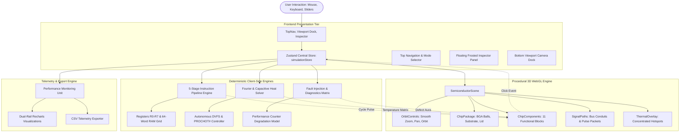
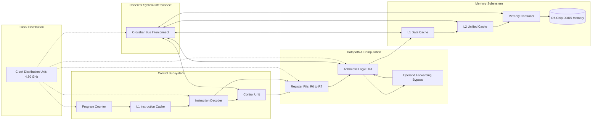
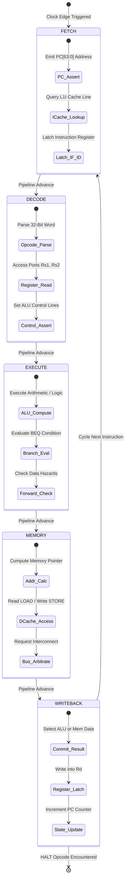
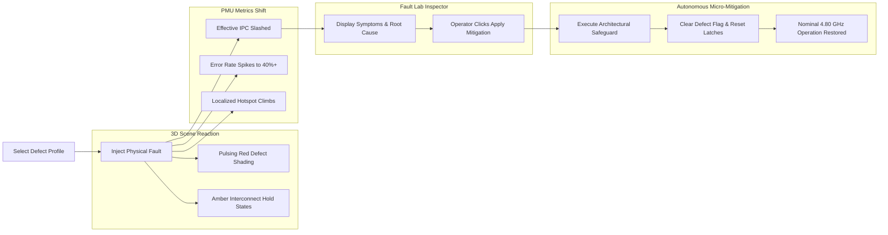

# SILICONVERSE

> Next-Generation Interactive Semiconductor Digital Twin, Microarchitectural Pipeline Simulator, and Thermodynamic Emulation Workstation

[](https://react.dev/)
[](https://www.typescriptlang.org/)
[](https://threejs.org/)
[](https://tailwindcss.com/)
[](LICENSE)
[]()
[]()

SILICONVERSE is an industrial-grade, client-side digital twin and microarchitectural simulation workstation for semiconductor engineering, computer systems education, and hardware verification research. It bridges the divide between theoretical computer architecture textbooks and real physical silicon by providing a procedural 3D physical die model, a cycle-accurate 5-stage RISC instruction pipeline, a live thermodynamic heat diffusion solver with autonomous hardware throttling (`PROCHOT#`), a hardware fault injection laboratory, and a real-time Performance Monitoring Unit (PMU) with instant telemetry export.

All physics, graphics, logic evaluations, and thermal calculations execute 100% locally in the browser with zero cloud dependencies, zero backend infrastructure, and zero physical electronics required.

---

## Master Table of Contents

1. [Executive Summary](#1-executive-summary)
2. [Problem Statement](#2-problem-statement)
   * [The Physical Silicon Black Box](#21-the-physical-silicon-black-box)
   * [Prohibitive Cleanroom and Laboratory Costs](#22-prohibitive-cleanroom-and-laboratory-costs)
   * [The Pedagogical Abstraction Gap](#23-the-pedagogical-abstraction-gap)
   * [High Financial and Time Stakes of Pre-Silicon Defect Misses](#24-high-financial-and-time-stakes-of-pre-silicon-defect-misses)
3. [Proposed Solution](#3-proposed-solution)
   * [The Digital Twin Paradigm](#31-the-digital-twin-paradigm)
   * [Zero-Barrier Client-Side Architecture](#32-zero-barrier-client-side-architecture)
   * [Multi-Physics and Logic Co-Simulation Engine](#33-multi-physics-and-logic-co-simulation-engine)
4. [Significance and Real-World Impact](#4-significance-and-real-world-impact)
   * [For Academic Institutions and Educators](#41-for-academic-institutions-and-educators)
   * [For Fabless Semiconductor Architects and Systems Engineers](#42-for-fabless-semiconductor-architects-and-systems-engineers)
   * [For Embedded Systems and Firmware Developers](#43-for-embedded-systems-and-firmware-developers)
   * [For Mission-Critical Aerospace, Automotive, and Defense Research](#44-for-mission-critical-aerospace-automotive-and-defense-research)
5. [System Architecture and Mind Maps](#5-system-architecture-and-mind-maps)
   * [High-Level System Architecture](#51-high-level-system-architecture)
   * [Quantum-X9 Microarchitecture Bus Topology](#52-quantum-x9-microarchitecture-bus-topology)
   * [Pipeline State Transition Machine](#53-pipeline-state-transition-machine)
   * [Closed-Loop Thermodynamic and DVFS Feedback Engine](#54-closed-loop-thermodynamic-and-dvfs-feedback-engine)
   * [Fault Injection and Mitigation Lifecycle](#55-fault-injection-and-mitigation-lifecycle)
6. [Core Platform Capabilities and Functional Modules](#6-core-platform-capabilities-and-functional-modules)
   * [Interactive 3D Semiconductor Canvas](#61-interactive-3d-semiconductor-canvas)
   * [Multi-Tier Exploded Dissection System](#62-multi-tier-exploded-dissection-system)
   * [Cycle-Accurate 5-Stage Pipeline Engine](#63-cycle-accurate-5-stage-pipeline-engine)
   * [Deterministic 64-Bit RISC Assembly Simulator](#64-deterministic-64-bit-risc-assembly-simulator)
   * [Virtual Hardware Fault Injection Laboratory](#65-virtual-hardware-fault-injection-laboratory)
   * [Thermodynamic Diffusion and DVFS Throttling Model](#66-thermodynamic-diffusion-and-dvfs-throttling-model)
   * [Performance Monitoring Unit and Telemetry Analytics](#67-performance-monitoring-unit-and-telemetry-analytics)
   * [Context-Aware AI Engineering Assistant](#68-context-aware-ai-engineering-assistant)
   * [Ready-Made Academic Experiment Library](#69-ready-made-academic-experiment-library)
7. [The 11 Functional Silicon Units](#7-the-11-functional-silicon-units)
8. [Instruction Set Architecture Reference](#8-instruction-set-architecture-reference)
9. [Mathematical Foundations and Equations](#9-mathematical-foundations-and-equations)
   * [Dynamic Switching and Static Leakage Power](#91-dynamic-switching-and-static-leakage-power)
   * [RC Network Heat Dissipation and Hotspot Formation](#92-rc-network-heat-dissipation-and-hotspot-formation)
   * [Autonomous DVFS Frequency Scaling Law](#93-autonomous-dvfs-frequency-scaling-law)
   * [Pipeline Throughput and Hazard Latency Metrics](#94-pipeline-throughput-and-hazard-latency-metrics)
10. [Preloaded Assembly Program Reference](#10-preloaded-assembly-program-reference)
11. [Hardware Defect Profiles and Mitigation Matrix](#11-hardware-defect-profiles-and-mitigation-matrix)
12. [Comparative Operating Scenarios Benchmark](#12-comparative-operating-scenarios-benchmark)
13. [Project Directory Structure](#13-project-directory-structure)
14. [Technology Stack](#14-technology-stack)
15. [Installation and Verification](#15-installation-and-verification)
16. [Deployment](#16-deployment)
17. [License and Attribution](#17-license-and-attribution)

---

## 1. Executive Summary

SILICONVERSE is designed to democratize semiconductor engineering. Modern microprocessors contain tens of billions of nanometer-scale transistors operating at gigahertz frequencies. Despite their profound civilizational importance, understanding how a modern processor works remains extraordinarily difficult because physical chips are sealed black boxes.

SILICONVERSE delivers an interactive digital twin of a fictional high-performance 64-bit superscalar processor: the **Quantum-X9**. Through procedural 3D WebGL rendering, physical packaging dissection, cycle-accurate instruction stepping, live thermodynamic simulation, and failure injection, SILICONVERSE provides users with an intuitive, tangible understanding of microarchitectural principles that previously required multi-million dollar cleanroom equipment.

```
===================================================================================
                                SILICONVERSE
                 Next-Gen Semiconductor Digital Twin Workstation
===================================================================================
  [ 3D PHYSICAL LAYER ]         [ LOGIC & PIPELINE ]        [ THERMODYNAMICS & FAULTS ]
  - Procedural Silicon Die       - 5-Stage RISC Pipeline     - Capacitive Heat Dissipation
  - Ceramic BGA Substrate        - Live Registers (R0 to R7) - PROCHOT# Autonomous Throttling
  - 11 Functional Blocks         - 64-Word RAM Hex View      - 6 Hardware Defect Scenarios
  - Continuous Exploded View     - Cycle Step & Run Modes    - Automated Micro-Mitigations
===================================================================================
```

---

## 2. Problem Statement

### 2.1 The Physical Silicon Black Box
Physical semiconductor chips cannot be visually inspected or probed during active runtime. Modern processors utilize nanometer-scale photolithography (e.g., 3nm, 5nm) encased beneath an opaque nickel-plated copper Integrated Heat Spreader (IHS), structural epoxy underfills, and multilayer ceramic substrates. Once manufactured, the internal movement of electrons, clock distribution pulses, and bus transactions are entirely invisible to the human eye.

### 2.2 Prohibitive Cleanroom and Laboratory Costs
* Building a modern leading-edge semiconductor fabrication cleanroom requires capital expenditures exceeding \$15 Billion to \$20 Billion USD.
* High-speed physical test benches equipped with digital oscilloscopes, high-bandwidth logic analyzers, and thermal chamber fixtures cost upwards of \$250,000 USD per student station.
* Consequently, over 95% of universities and engineering colleges worldwide cannot provide hands-on physical semiconductor analysis, reducing computer architecture education to passive memorization of 2D textbook diagrams.

### 2.3 The Pedagogical Abstraction Gap
In computer science curricula, students often write software or assembly code without developing an intuitive spatial and temporal mental model of the underlying hardware:
* How does an instruction physically travel from an instruction cache into an instruction decoder?
* Why does a cache miss cause an execution stall?
* What does a thermal runaway event actually look like across the surface of a die?
* How does the clock distribution unit synchronize billions of gates without signal skew?

Traditional 2D static block diagrams fail to convey these spatial and physical realities.

### 2.4 High Financial and Time Stakes of Pre-Silicon Defect Misses
In industrial semiconductor manufacturing, catching an architectural defect post-silicon is catastrophic:
* A single mask respin can cost between \$5 Million and \$25 Million USD depending on the node.
* A tape-out respin introduces 6 to 9 months of market delay, frequently destroying product profitability.
* Engineers require intuitive exploration environments to stress-test interconnect arbitration, thermal boundary conditions, and fault tolerance strategies prior to physical tape-out.

---

## 3. Proposed Solution

### 3.1 The Digital Twin Paradigm
SILICONVERSE solves these challenges by providing an interactive software-defined digital twin of the **Quantum-X9** processor. By coupling procedural 3D geometric visualization with mathematical simulation engines, users can inspect, disassemble, step through, and intentionally break a virtual microprocessor with instant visual feedback.

### 3.2 Zero-Barrier Client-Side Architecture
* **Pure WebGL and React 19**: Runs directly inside standard modern web browsers (Chrome, Edge, Firefox, Safari) without requiring native plugins, special drivers, or external runtimes.
* **100% Deterministic Local Execution**: All logic simulation, assembly parsing, thermodynamic equation solving, and telemetry graphing are calculated client-side in TypeScript.
* **No Cloud API Keys or Subscription Fees**: Accessible anywhere, on any computer with WebGL capabilities, at zero operational cost.

### 3.3 Multi-Physics and Logic Co-Simulation Engine
SILICONVERSE synchronizes four interdependent real-time simulation engines:
1. **Geometric Layer**: Renders an accurate multi-layer package with BGA solder spheres, ceramic substrate, silicon die, gold bond pads, functional core blocks, and translucent lid.
2. **Logic & Pipeline Layer**: Executes 64-bit RISC assembly code across a cycle-accurate 5-stage pipeline with register files, RAM buffers, and data hazard detection.
3. **Thermodynamic Layer**: Computes real-time dynamic switching power ($P = C \cdot V^2 \cdot f$), static leakage power, and junction temperatures with an autonomous hardware `PROCHOT#` protection tripwire.
4. **Fault & Diagnostic Layer**: Injects physical defects (ALU logic failures, SRAM bit flips, clock jitter, interconnect deadlocks) and tracks error propagation through hardware performance counters.

---

## 4. Significance and Real-World Impact

```
+-------------------------------------------------------------------------------------------------+
|                                SILICONVERSE STRATEGIC IMPACT                                    |
+-------------------------------------------------------------------------------------------------+
|                                                                                                 |
|   ACADEMIA & EDUCATION             INDUSTRY & ARCHITECTS           FIRMWARE & SECURITY          |
|   --------------------             ---------------------           -------------------          |
|   - Zero-cost virtual lab          - Floorplan thermal audits      - Architectural empathy      |
|   - Visual pipeline stepping       - Interconnect deadlock test    - Cache locality analysis    |
|   - Hands-on defect analysis       - Pre-tapeout sanity checks     - Fault mitigation design    |
|                                                                                                 |
+-------------------------------------------------------------------------------------------------+
```

### 4.1 For Academic Institutions and Educators
* **Replaces Inaccessible Equipment**: Delivers the functional equivalent of an interactive logic analyzer and thermal camera setup inside any browser.
* **Bridging Theory and Intuition**: Instructors can project SILICONVERSE during lectures to demonstrate pipeline stalls, register forwarding, branch mispredictions, and cache line misses live.
* **Interactive Assignments**: Students can complete guided laboratory assignments, test custom assembly code, and observe internal state changes directly.

### 4.2 For Fabless Semiconductor Architects and Systems Engineers
* **Spatial Floorplan Awareness**: Provides an intuitive view of component placement, demonstrating how spatial proximity impacts interconnect latency and thermal density.
* **Thermal Hotspot Exploration**: Illustrates how localized power surges (e.g., intensive ALU workloads) create thermal hotspots that trigger system-wide frequency throttling.

### 4.3 For Embedded Systems and Firmware Developers
* **Low-Level Software Empathy**: Helps software engineers understand how specific instruction sequences exercise the hardware, revealing the microarchitectural cost of cache-unfriendly memory access patterns.
* **Hardware Exception Handling**: Demonstrates the real hardware conditions that cause interrupts, bus faults, and emergency thermal throttling events.

### 4.4 For Mission-Critical Aerospace, Automotive, and Defense Research
* **Radiation and Soft-Error Resilience**: Emulates cosmic-ray single-event upsets (SEUs) such as SRAM cache bit flips and register file metastability.
* **Safe-Mode Mitigation Verification**: Enables engineers to test lockstep execution, error-correcting codes (ECC), and cache invalidation routines in a safe, visual sandbox.

---

## 5. System Architecture and Mind Maps

### 5.1 High-Level System Architecture



### 5.2 Quantum-X9 Microarchitecture Bus Topology



### 5.3 Pipeline State Transition Machine



### 5.4 Closed-Loop Thermodynamic and DVFS Feedback Engine

```mermaid
flowchart TD
    Clock[Base Clock: 4.80 GHz] --> Workload[Workload Slider: 0% to 100%]
    Workload --> DynamicPwr[Compute Dynamic Power: P_dyn = C * V^2 * f]
    Ambient[Ambient Temp: 24 C] --> TempSolver[Numerical Junction Temperature Solver]
    Fan[Cooling Fan: 10% to 100%] --> TempSolver
    DynamicPwr --> TempSolver
    Leakage[Static Leakage Power: P_leak f(T)] --> TempSolver

    TempSolver --> HotspotCheck{Peak Junction Temp >= 92.0 C?}

    HotspotCheck -->|Yes: Overheat Condition| AssertPROCHOT[Assert Hardware PROCHOT# Signal]
    HotspotCheck -->|No: Thermal Equilibrium| NominalRun[Maintain Target Frequency]

    AssertPROCHOT --> EngageDVFS[Engage Dynamic Voltage & Frequency Scaling]
    EngageDVFS --> SlashClock[Throttle Clock: 4.80 GHz -> 1.40 GHz]
    EngageDVFS --> DropVoltage[Drop Core Voltage: 1.12 V -> 0.85 V]
    SlashClock --> DynamicPwr
    DropVoltage --> DynamicPwr
    DynamicPwr --> Cooldown[Die Cools Back Below 92 C Threshold]
    Cooldown --> DeassertPROCHOT[Deassert PROCHOT# after Hysteresis]
    DeassertPROCHOT --> Clock
```

### 5.5 Fault Injection and Mitigation Lifecycle



---

## 6. Core Platform Capabilities and Functional Modules

SILICONVERSE provides 9 unified modules accessible from the sleek top navigation bar:

```
[1. 3D Chip Tour]       -> Full-viewport interactive procedural 3D model, camera controls, component inspector
[2. Exploded View]      -> Continuous vertical separation slider (0% to 100%) across 5 packaging tiers
[3. Data Flow]          -> 5-stage pipeline runner (Fetch, Decode, Execute, Memory, Writeback)
[4. Assembly Lab]       -> 64-bit RISC assembly code editor, live registers (R0 to R7), 64-word RAM grid
[5. Fault Testing]      -> Hardware defect injection lab with side-by-side metric comparison
[6. Thermal Heatmap]    -> Dynamic heat diffusion model with workload & cooling sliders and PROCHOT#
[7. Telemetry PMU]      -> Real-time Recharts graphs for clock, power, temperatures, IPC, and bandwidth
[8. Ask AI Assistant]   -> Context-aware technical assistant with local microarchitectural knowledge
[9. Experiment Guide]   -> Ready-made academic scenarios with step-by-step hypothesis walkthroughs
```

### 6.1 Interactive 3D Semiconductor Canvas
* **Procedural Geometry Engine**: Renders a complete physical microprocessor package with over 100 individual Ball Grid Array (BGA) solder spheres, a multilayer ceramic substrate, gold wire bond pads, a silicon die, and a semi-translucent protective nickel lid.
* **Camera Director**: Features smooth orbit, pan, and zoom controls powered by Three.js `OrbitControls`. Includes instant preset camera viewpoints:
  * **Default Isometric View**: Ideal for overall architectural inspection.
  * **Top-Down Floorplan View**: Aligns the camera directly above the silicon die for spatial layout study.
  * **Execution Core Focus**: Centers the camera on the Arithmetic Logic Unit (ALU) and Register File.
  * **Auto-Rotate Toggle**: Rotates the chip smoothly for laboratory demonstration.
  * **Interactive Component Highlighting**: Clicking any functional block outlines the geometry with a neon cyan wireframe and opens a comprehensive floating inspector.

### 6.2 Multi-Tier Exploded Dissection System
* **Continuous Separation Slider**: Smoothly translates the packaging layers vertically from 0% (fully packaged) to 100% (fully exploded).
* **5 Distinct Physical Layers**:
  1. **Package Layer**: Protective nickel-plated copper lid ($Y = 1.6$).
  2. **Substrate Layer**: Multilayer ceramic printed circuit board carrier with BGA solder spheres ($Y = -0.5$).
  3. **Silicon Die Layer**: Monolithic silicon base substrate ($Y = 0.0$).
  4. **Functional Block Layer**: The 11 microarchitectural core execution blocks ($Y = 0.22$).
  5. **Interconnection Layer**: High-speed crossbar bus lines and power distribution networks ($Y = 0.42$).
* **Individual Layer Isolation**: Toggle switches allow isolating or hiding any tier for focused cross-sectional analysis.

### 6.3 Cycle-Accurate 5-Stage Pipeline Engine
* **Visual Data Flow**: Conduits light up in sequence as instructions traverse the 5 pipeline stages:
  $$\text{FETCH} \longrightarrow \text{DECODE} \longrightarrow \text{EXECUTE} \longrightarrow \text{MEMORY} \longrightarrow \text{WRITEBACK}$$
* **Stepping Modes**:
  * **Step Stage**: Advances the pipeline by one microarchitectural phase.
  * **Step Instruction**: Advances the pipeline through all 5 stages for the current instruction.
  * **Continuous Run**: Automatically steps the pipeline at user-adjustable speeds (from 100ms to 2000ms per stage).
* **Pipeline Hazard Visibility**: Stalls caused by data dependencies (e.g., read-after-write hazards) are highlighted with visual pause states.

### 6.4 Deterministic 64-Bit RISC Assembly Simulator
* **Live Assembly Editor**: Allows writing custom 64-bit assembly programs with syntax highlighting and instant error reporting.
* **Preloaded Program Library**: Includes ready-made algorithms:
  * **Fibonacci Sequence**: Computes sequence terms and writes them into sequential RAM addresses.
  * **Vector Dot Product**: Multiplies two integer vectors and accumulates the scalar result into register R0.
  * **Arithmetic Stress Test**: Exercises all ALU mathematical and logical opcodes.
  * **Memory Stride Benchmark**: Demonstrates cache line hits vs misses across non-contiguous addresses.
* **Live Register File**: Visualizes 64-bit registers R0 through R7 in both hexadecimal and decimal representations.
* **Interactive 64-Word RAM Grid**: Displays memory contents across 64 addresses, highlighting write locations in real time.

### 6.5 Virtual Hardware Fault Injection Laboratory
* **Controlled Physical Failure Scenarios**: Inject 6 realistic defect profiles into target hardware blocks.
* **Dual-Column Telemetry Comparison**: Directly compares baseline nominal metrics against faulted metrics:
  * Effective IPC (Instructions Per Cycle)
  * Error Rate Percentage
  * Thermal Hotspot Delta
  * Active Clock Speed
* **Root-Cause Diagnostic Console**: Explains the exact physical and electrical failure mechanism behind each defect.
* **One-Click Micro-Mitigation**: Executes the appropriate architectural fix (e.g., cache invalidate, pipeline bubble insertion, clock failover) and observes system recovery.

### 6.6 Thermodynamic Diffusion and DVFS Throttling Model
* **Interactive Physics Sliders**:
  * **Workload Slider (0% to 100%)**: Scales dynamic switching activity across all functional units.
  * **Cooling Fan Slider (10% to 100%)**: Adjusts forced-air thermal dissipation efficiency.
* **Dynamic Color-Coded Hotspot Shading**: As temperatures rise, functional blocks visually shift from cool blue ($28^\circ\text{C}$) to vibrant amber ($65^\circ\text{C}$) to pulsing critical red ($92^\circ\text{C}+$).
* **Autonomous Hardware `PROCHOT#` Protection**: When any unit reaches $92.0^\circ\text{C}$, the hardware asserts the `PROCHOT#` signal, instantly slashing the clock frequency from 4.80 GHz to 1.40 GHz to prevent electromigration damage.

### 6.7 Performance Monitoring Unit and Telemetry Analytics
* **Real-Time Dual-Rail Graphs**: Powered by Recharts, plotting:
  * Core Frequency (GHz) vs. Dynamic Power Consumption (W)
  * Peak Junction Temperature ($^\circ\text{C}$) vs. Average Die Temperature ($^\circ\text{C}$)
  * Effective IPC Throughput vs. Memory Bus Bandwidth (GB/s)
* **One-Click CSV Export**: Exports a rolling buffer of timestamped hardware telemetry data for external analysis in Python, MATLAB, or Microsoft Excel.

### 6.8 Context-Aware AI Engineering Assistant
* **Embedded Domain Specialist**: Provides instant microarchitectural guidance, answers technical questions about pipeline hazards, cache coherence, and thermal equations, and suggests optimization strategies.
* **Contextually Aware**: The assistant reads the active component selection, current fault state, and thermal status to provide relevant advice.

### 6.9 Ready-Made Academic Experiment Library
* **Structured Laboratory Curriculum**: Includes 6 guided experiments designed for computer architecture and VLSI courses.
* **Hypothesis-Driven**: Each experiment outlines the theoretical hypothesis, step-by-step instructions, and expected telemetry observations.

---

## 7. The 11 Functional Silicon Units

The Quantum-X9 processor die houses 11 distinct procedural functional blocks. Each unit is characterized by complete technical metadata:

| Unit Name | Category | Transistors | Die Area | Power (TDP) | Clock Domain | Position [X, Y, Z] | Dimensions [W, H, D] | Real-World Analogy |
| :--- | :--- | :--- | :--- | :--- | :--- | :--- | :--- | :--- |
| **Arithmetic Logic Unit (ALU)** | Execution | 380 Million | 2.84 mm² | 24.5 W | 4.80 GHz | [-1.4, 0.22, 1.3] | [2.2, 0.35, 1.8] | The pistons in a car engine performing mechanical work. |
| **Control Unit (CU)** | Control | 190 Million | 1.45 mm² | 8.2 W | 4.80 GHz | [1.4, 0.22, 1.3] | [2.0, 0.35, 1.8] | An air traffic controller directing flights to avoid collisions. |
| **Register File (PRF)** | Storage | 95 Million | 0.92 mm² | 6.4 W | 4.80 GHz | [0.0, 0.22, 0.0] | [1.8, 0.38, 1.4] | Tools in an artisan's hand on the workbench instead of in storage. |
| **L1 Instruction Cache (L1I)** | Storage | 520 Million | 3.10 mm² | 11.2 W | 4.80 GHz | [-2.8, 0.22, -0.6] | [1.6, 0.32, 2.2] | Having a recipe book open to the exact page being cooked. |
| **L1 Data Cache (L1D)** | Storage | 540 Million | 3.25 mm² | 12.8 W | 4.80 GHz | [2.8, 0.22, -0.6] | [1.6, 0.32, 2.2] | Ingredients washed, chopped, and waiting on the cutting board. |
| **L2 Unified Cache (L2)** | Storage | 1.85 Billion | 7.40 mm² | 19.6 W | 3.60 GHz | [0.0, 0.22, -2.4] | [5.2, 0.32, 1.5] | A refrigerator in the kitchen before needing a trip to the store. |
| **Memory Controller (MC)** | Interconnect | 410 Million | 3.60 mm² | 14.2 W | 3.20 GHz | [0.0, 0.22, -3.6] | [4.4, 0.28, 0.8] | The shipping and receiving loading dock of a central warehouse. |
| **Instruction Decoder** | Control | 160 Million | 1.30 mm² | 7.5 W | 4.80 GHz | [-1.4, 0.22, 0.0] | [1.8, 0.35, 1.4] | A multilingual interpreter translating foreign phrases into action items. |
| **Program Counter (PC)** | Control | 45 Million | 0.45 mm² | 3.1 W | 4.80 GHz | [-2.8, 0.22, 1.3] | [1.4, 0.35, 1.4] | A bookmark moving line-by-line down a page of instructions. |
| **Bus Interconnect** | Interconnect | 310 Million | 2.90 mm² | 16.5 W | 4.00 GHz | [0.0, 0.42, 0.0] | [5.8, 0.15, 4.8] | A multi-lane express highway linking all industrial districts in a city. |
| **Clock Distribution Unit** | Timing | 70 Million | 0.75 mm² | 9.8 W | 4.80 GHz | [0.0, 0.22, 2.5] | [1.6, 0.32, 1.0] | The steady beat of a conductor keeping an entire orchestra in sync. |

---

## 8. Instruction Set Architecture Reference

The Quantum-X9 processor executes an educational 64-bit RISC instruction set architecture (ISA):

| Opcode | Syntax Example | Format | Operational Behavior | Latency |
| :--- | :--- | :--- | :--- | :--- |
| **LOAD** | `LOAD R1, 10` or `LOAD R1, R2` | I / R-Type | Loads immediate constant or memory operand from source into register Rd. | 4 Cycles |
| **STORE** | `STORE R1, 20` | S-Type | Writes register operand Rs into RAM at destination memory address. | 1 Cycle (Buffered) |
| **ADD** | `ADD R3, R1, R2` | R-Type | Computes 64-bit addition: `Rd = Rs1 + Rs2`. | 1 Cycle |
| **SUB** | `SUB R4, R1, R2` | R-Type | Computes 64-bit subtraction: `Rd = Rs1 - Rs2`. | 1 Cycle |
| **MUL** | `MUL R5, R1, R2` | R-Type | Computes 64-bit integer multiplication: `Rd = Rs1 * Rs2`. | 2 Cycles |
| **AND** | `AND R6, R1, R2` | R-Type | Performs bitwise logical AND: `Rd = Rs1 & Rs2`. | 1 Cycle |
| **OR** | `OR R7, R1, R2` | R-Type | Performs bitwise logical OR: `Rd = Rs1 | Rs2`. | 1 Cycle |
| **XOR** | `XOR R0, R1, R2` | R-Type | Performs bitwise exclusive-OR: `Rd = Rs1 ^ Rs2`. | 1 Cycle |
| **JMP** | `JMP 12` | J-Type | Unconditionally redirects the Program Counter (PC) to target instruction address. | 1 Cycle |
| **BEQ** | `BEQ R1, R2, 8` | B-Type | Evaluates equality: if `Rs1 == Rs2`, branches PC to target; otherwise advances sequentially. | 1 Cycle |
| **HALT** | `HALT` | Special | Ceases pipeline clocking and enters low-power architectural sleep state. | 0 Cycles |

---

## 9. Mathematical Foundations and Equations

### 9.1 Dynamic Switching and Static Leakage Power

Total processor electrical power consumption ($P_{\text{total}}$) is calculated as the sum of dynamic switching power ($P_{\text{dyn}}$) and temperature-dependent subthreshold leakage power ($P_{\text{leak}}$):

$$P_{\text{total}} = P_{\text{dyn}} + P_{\text{leak}}$$

Where dynamic switching power is governed by CMOS capacitive charging:

$$P_{\text{dyn}} = \alpha \cdot C_{\text{eff}} \cdot V_{\text{dd}}^2 \cdot f$$

* $\alpha$ is the switching activity factor (scaled by the Workload slider: 0.0 to 1.0).
* $C_{\text{eff}}$ is the total effective gate switching capacitance (approximated at $18.5\text{ nF}$).
* $V_{\text{dd}}$ is the core supply voltage ($1.12\text{ V}$ nominal).
* $f$ is the operating clock frequency ($4.80\text{ GHz}$ nominal).

Static leakage power scales exponentially with junction temperature due to thermionic carrier emission over barrier potentials:

$$P_{\text{leak}}(T) = I_{\text{leak0}} \cdot V_{\text{dd}} \cdot \exp\left(\frac{T_{\text{junction}} - T_{\text{ref}}}{k_{\text{thermal}}}\right)$$

### 9.2 RC Network Heat Dissipation and Hotspot Formation

Thermal conduction through the silicon die to the ambient environment is modeled using a localized thermal resistance network:

$$T_{\text{junction}} = T_{\text{ambient}} + P_{\text{total}} \cdot \theta_{\text{JA}} \cdot \left(1.0 - \eta_{\text{fan}} \cdot 0.72\right)$$

* $T_{\text{ambient}}$ is baseline ambient room temperature ($24.0^\circ\text{C}$).
* $\theta_{\text{JA}}$ is the junction-to-ambient thermal resistance constant for each block (ranging from $0.42^\circ\text{C/W}$ for large cache blocks to $1.15^\circ\text{C/W}$ for dense execution logic).
* $\eta_{\text{fan}}$ is the forced-air cooling fan efficiency (scaled by the Fan slider: 0.10 to 1.00).

### 9.3 Autonomous DVFS Frequency Scaling Law

When junction temperature breaches the critical thermal budget:

$$T_{\text{junction}} \ge 92.0^\circ\text{C} \implies \text{Assert } \text{PROCHOT\#}$$

Upon assertion of `PROCHOT#`, the clock distribution unit clamps core frequency:

$$f_{\text{throttled}} = 1.40\text{ GHz} \quad \left(\text{slashed from } 4.80\text{ GHz}\right)$$

$$V_{\text{dd, throttled}} = 0.85\text{ V} \quad \left(\text{dropped from } 1.12\text{ V}\right)$$

Because dynamic power scales with $V^2 \cdot f$, this throttling slashes heat generation by:

$$\frac{P_{\text{throttled}}}{P_{\text{nominal}}} = \left(\frac{0.85}{1.12}\right)^2 \cdot \left(\frac{1.40}{4.80}\right) \approx 0.575 \cdot 0.292 \approx 0.168 \quad (83.2\% \text{ reduction})$$

### 9.4 Pipeline Throughput and Hazard Latency Metrics

Pipeline throughput is quantified via Instructions Per Cycle (IPC):

$$\text{IPC} = \frac{N_{\text{instructions}}}{N_{\text{cycles}}}$$

Where total elapsed clock cycles account for baseline execution cycles plus pipeline stall bubbles:

$$N_{\text{cycles}} = N_{\text{instructions}} + N_{\text{data stalls}} + N_{\text{branch penalties}} + N_{\text{cache misses}} \cdot L_{\text{miss}}$$

* $L_{\text{miss, L1}}$ is L1 cache miss latency penalty (12 cycles).
* $L_{\text{miss, L2}}$ is L2 cache miss latency penalty to main DDR5 memory (64 cycles).

---

## 10. Preloaded Assembly Program Reference

SILICONVERSE provides 4 preloaded assembly algorithms demonstrating key computer architecture concepts:

### 10.1 Fibonacci Sequence Generator
Generates the first 8 numbers in the Fibonacci sequence and writes them to sequential RAM addresses:
```assembly
LOAD R1, 0        ; F(0) = 0
LOAD R2, 1        ; F(1) = 1
STORE R1, 10      ; RAM[10] = 0
STORE R2, 11      ; RAM[11] = 1
ADD R3, R1, R2    ; F(2) = 0 + 1 = 1
STORE R3, 12      ; RAM[12] = 1
ADD R1, R2, R3    ; F(3) = 1 + 1 = 2
STORE R1, 13      ; RAM[13] = 2
ADD R2, R3, R1    ; F(4) = 1 + 2 = 3
STORE R2, 14      ; RAM[14] = 3
ADD R3, R1, R2    ; F(5) = 2 + 3 = 5
STORE R3, 15      ; RAM[15] = 5
HALT              ; Terminate execution
```

### 10.2 Vector Dot Product
Emulates a SIMD integer dot product: computes $A[0] \cdot B[0] + A[1] \cdot B[1] + A[2] \cdot B[2]$:
```assembly
LOAD R1, 3        ; Vector A[0] = 3
LOAD R2, 4        ; Vector B[0] = 4
MUL R3, R1, R2    ; R3 = 3 * 4 = 12
LOAD R4, 5        ; Vector A[1] = 5
LOAD R5, 2        ; Vector B[1] = 2
MUL R6, R4, R5    ; R6 = 5 * 2 = 10
ADD R0, R3, R6    ; R0 = 12 + 10 = 22
LOAD R1, 6        ; Vector A[2] = 6
LOAD R2, 3        ; Vector B[2] = 3
MUL R3, R1, R2    ; R3 = 6 * 3 = 18
ADD R0, R0, R3    ; R0 = 22 + 18 = 40 (Accumulated total)
STORE R0, 30      ; Write final scalar to RAM[30]
HALT
```

### 10.3 Arithmetic Stress Test
Exhaustively exercises the Arithmetic Logic Unit (ALU) functional datapath:
```assembly
LOAD R1, 15
LOAD R2, 7
ADD R3, R1, R2    ; R3 = 15 + 7 = 22
SUB R4, R1, R2    ; R4 = 15 - 7 = 8
MUL R5, R1, R2    ; R5 = 15 * 7 = 105
AND R6, R1, R2    ; R6 = 15 & 7 = 7
OR R7, R1, R2     ; R7 = 15 | 7 = 15
XOR R0, R1, R2    ; R0 = 15 ^ 7 = 8
HALT
```

### 10.4 Memory Stride Benchmark
Demonstrates cache line locality and strided memory latency:
```assembly
LOAD R1, 42
STORE R1, 0       ; Cache line 0 hit
STORE R1, 4       ; Stride +4
STORE R1, 8       ; Stride +8
STORE R1, 12      ; Stride +12
LOAD R2, 0        ; Read back verified
LOAD R3, 4
LOAD R4, 8
LOAD R5, 12
HALT
```

---

## 11. Hardware Defect Profiles and Mitigation Matrix

SILICONVERSE models 6 realistic physical failure modes:

| Fault Scenario | Target Block | Electrical Mechanism | System Symptoms | Mitigating Action |
| :--- | :--- | :--- | :--- | :--- |
| **ALU Carry Adder Breakdown** | ALU | Carry-lookahead gate electromigration breakdown. | Computation parity errors, IPC falls from 2.45 to 0.78, localized temp surges by +18.5°C. | Reroute arithmetic to secondary ALU lane; enable lockstep validation. |
| **L1D Cache Tag Bit Flip** | L1 Data Cache | Cosmic-ray soft-error single-event upset (SEU) in SRAM cell. | L1 miss rate surges to 48.2%, cache misses stall pipeline, memory bus congestion. | Assert cache line invalidate and flush command; quarantine faulty way bank. |
| **Register Multi-Port Timing Race** | Register File | Metastability race condition during concurrent read/write ports. | Operand corruption, throughput drops by 45%, false condition evaluations. | Insert hardware pipeline stall bubbles between dependent register accesses. |
| **Interconnect Crossbar Deadlock** | Bus Interconnect | Credit arbiter circular deadlock halting packet routing. | 100% pipeline freeze on all memory loads/stores, throughput slashed by 88%. | Pulse crossbar credit arbiter reset line; reroute coherent traffic to bypass ring. |
| **Clock Distribution Phase Jitter** | Clock Unit | Thermal phase noise in PLL voltage-controlled oscillator. | Widespread setup/hold timing violations, core frequency throttled to 2.0 GHz. | Switch reference clock to auxiliary crystal oscillator; emergency downclock. |
| **Thermal Runaway Hotspot** | Control Unit | Thermal interface breakdown with junction temperatures exceeding 104°C. | Severe hardware throttling (PROCHOT# asserted), core frequency slashed to 1.40 GHz. | Engage auxiliary cooling fans (100% RPM); migrate active thread execution. |

---

## 12. Comparative Operating Scenarios Benchmark

| Operating Scenario | Workload | Clock Speed | TDP Power | Peak Junction Temp | Effective IPC | Status Description |
| :--- | :--- | :--- | :--- | :--- | :--- | :--- |
| **Idle Baseline** | 10% | 1.80 GHz | 24.5 W | 31.2°C | 0.80 | Low-power idle state |
| **Nominal Superscalar** | 45% | 4.80 GHz | 54.2 W | 48.5°C | 2.45 | Balanced multi-threaded workload |
| **Heavy Vector Stress** | 95% | 4.80 GHz | 92.4 W | 76.8°C | 2.80 | Peak scientific matrix multiplication |
| **ALU Hardware Failure** | 65% | 3.60 GHz | 62.0 W | 68.0°C | 0.78 | Arithmetic anomaly and replay stalls |
| **Thermal Runaway Safe-Mode** | 100% | 1.40 GHz | 88.5 W | 104.2°C | 0.65 | PROCHOT# asserted, frequency throttled |

---

## 13. Project Directory Structure

```
c:\Users\Asus\Downloads\Ai chip\
├── src\
│   ├── components\
│   │   └── layout\
│   │       ├── TopNav.tsx             (Header navigation bar with mode pills, scenario selector, telemetry badge)
│   │       ├── LeftNav.tsx            (Compact sidebar navigation rail with live badge counters)
│   │       ├── RightInspector.tsx     (Floating frosted glass card with plain-English component summaries)
│   │       └── BottomStatus.tsx       (Bottom cycle ticker, instruction counter, and simulation speed slider)
│   ├── scenes\
│   │   ├── SemiconductorScene.tsx     (Three.js canvas, OrbitControls, camera director, lighting, ground grid)
│   │   ├── ChipPackage.tsx            (Procedural BGA solder balls, PCB substrate, gold bond pads, nickel lid)
│   │   ├── ChipComponents.tsx         (11 functional silicon blocks with dynamic thermal heatmap shaders)
│   │   ├── SignalPaths.tsx            (Glowing bus conduits and traveling animated pulse packets)
│   │   └── ThermalOverlay.tsx         (Hotspot aura and thermodynamic radiation rings)
│   ├── modules\
│   │   ├── explorer\ExplorerModule.tsx               (Full-screen 3D exploration and camera presets)
│   │   ├── dissection\DissectionModule.tsx           (Exploded architecture slider and tier visibility toggles)
│   │   ├── signal-flow\SignalFlowModule.tsx         (5-stage pipeline runner and signal bus inspector)
│   │   ├── instruction-simulator\InstructionSimulatorModule.tsx (Assembly editor, registers, RAM grid)
│   │   ├── fault-lab\FaultLabModule.tsx             (Hardware failure injection and diagnostics)
│   │   ├── thermal-analysis\ThermalAnalysisModule.tsx (Workload slider, fan cooling, thermal throttling)
│   │   ├── analytics\PerformanceAnalyticsModule.tsx (Recharts live telemetry graphs, CSV export)
│   │   ├── assistant\EngineeringAssistantModule.tsx (Local microarchitecture AI assistant)
│   │   ├── docs\DocsAndScenariosModule.tsx           (Academic guided experiments and ISA reference)
│   │   ├── architecture\ArchitectureStudioModule.tsx (Block diagram topology, clock domains, latency)
│   │   └── overview\OverviewModule.tsx               (Executive system overview dashboard)
│   ├── engine\
│   │   ├── instructionEngine.ts       (64-bit RISC assembly engine and 5-stage pipeline)
│   │   └── thermalEngine.ts           (Thermodynamic diffusion and PMU telemetry calculator)
│   ├── stores\
│   │   └── simulationStore.ts         (Centralized Zustand reactive state store)
│   ├── data\
│   │   ├── chipComponents.ts          (Technical specifications, dimensions, coordinates, analogies)
│   │   └── scenarios.ts               (Predefined fault profiles, sample programs, guided labs)
│   ├── types\
│   │   └── index.ts                   (Strict TypeScript contracts and interfaces)
│   ├── App.tsx                        (Master layout shell and simulation ticking loop)
│   ├── index.css                      (Tailwind v4 theme, engineering scrollbars, tech grids)
│   └── main.tsx                       (React root mount entry point)
├── README.md                          (Comprehensive engineering specification manual)
├── index.html                         (Head metadata, typography: Inter, JetBrains Mono)
├── tsconfig.app.json                  (Strict TypeScript compiler options and path aliases)
├── package.json                       (Dependencies, build scripts, package metadata)
└── vite.config.ts                     (Vite bundler, Tailwind v4, and path alias configuration)
```

---

## 14. Technology Stack

* **Frontend Framework**: React 19 with TypeScript 5.8
* **Build System**: Vite 6.2 with lightning-fast Hot Module Replacement (HMR)
* **3D WebGL Engine**: Three.js r187, React Three Fiber (R3F) v9, `@react-three/drei`
* **Styling & Design System**: Tailwind CSS v4.3 with custom engineering color tokens
* **State Management**: Zustand v5
* **Data Visualization**: Recharts v2.15
* **Iconography**: Lucide React
* **Type Safety**: 100% strict TypeScript with zero any-casting in core calculation routines

---

## 15. Installation and Verification

### Prerequisites
* **Node.js**: Version 18.0.0 or higher
* **npm**: Version 9.0.0 or higher

### Step-by-Step Installation

1. **Clone the repository**:
   ```bash
   git clone https://github.com/your-username/siliconverse.git
   cd siliconverse
   ```

2. **Install dependencies**:
   ```bash
   npm install
   ```

3. **Start the local development server**:
   ```bash
   npm run dev
   ```
   Open `http://localhost:5173/` in your browser.

4. **Verify TypeScript compilation and production build**:
   ```bash
   npm run build
   ```
   Ensures zero compilation errors, zero missing imports, and produces an optimized production bundle in `dist/`.

5. **Preview the production build locally**:
   ```bash
   npm run preview
   ```
   Open `http://localhost:4173/` to interact with the verified production bundle.

---

## 16. Deployment

SILICONVERSE is designed for zero-config deployment on Vercel:

```bash
npx vercel
```

Alternatively, the contents of the `dist/` directory produced by `npm run build` can be deployed to any static web hosting platform including GitHub Pages, Cloudflare Pages, Netlify, or AWS S3.

---

## 17. License and Attribution

Distributed under the MIT License. Designed and engineered for semiconductor education, computer architecture research, and digital twin simulation.
